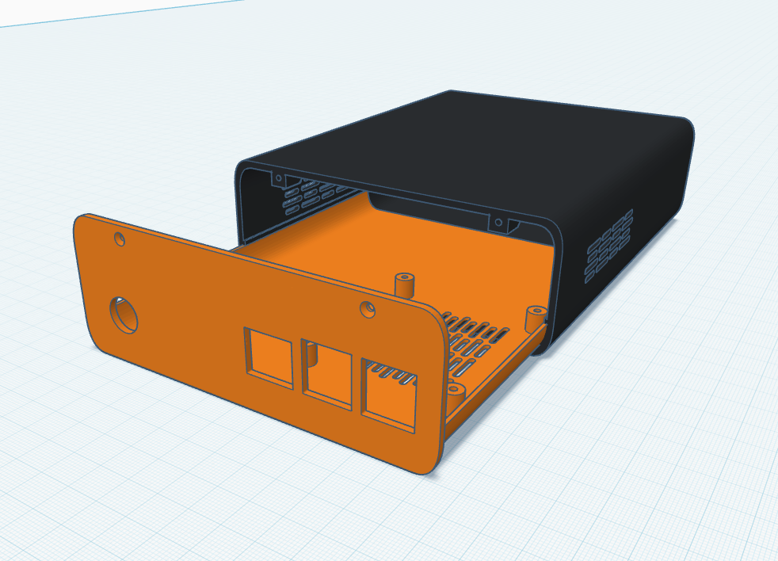

<p align="center">
  <picture>
    <source media="(prefers-color-scheme: dark)" srcset="https://raw.githubusercontent.com/Koberum/Sonect/main/packages/frontend/public/sonect-logo-dark.svg">
    <source media="(prefers-color-scheme: light)" srcset="https://raw.githubusercontent.com/Koberum/Sonect/main/packages/frontend/public/sonect-logo-light.svg">
    
  </picture>
</p>

<p align="center">
  <em>Self-hosted music streaming, powered by <a href="https://www.musicpd.org/">Music Player Daemon</a>.</em>
</p>

<p align="center">
  <a href="https://sonect.dev"></a>
  <a href="https://github.com/Koberum/Sonect/actions/workflows/ci.yml"></a>
  <a href="https://github.com/Koberum/Sonect/actions/workflows/release.yml"></a>
  <a href="LICENSE"></a>
</p>

---

Sonect wraps MPD in a modern React interface. Browse your library by album,
artist, or genre, control playback in real time, and never depend on a
streaming service again. Everything runs on your own hardware — no telemetry,
no subscriptions, no limits.

---

## Features

- **Accounts and roles** — first-run setup creates the administrator; every
  household member then signs in with their own profile and password. Admins
  manage libraries, audio, sync, and profiles; users can browse, listen, use
  playlists, and change their own password.
- **MPD-powered playback** — Gapless, battle-tested, supports virtually any
  audio format. Random and repeat have UI controls; `consume` is forced by the
  queue engine and `single` is reflected from MPD status.
- **MPD-backed catalog** — Sonect mirrors MPD's indexed database instead of
  scanning tags itself. The first sync is full; later syncs are incremental and
  skip entirely when MPD reports no changes. Track names stream in the status
  bar while the catalog is imported.
- **Live WebSocket state** — Playback changes reflect instantly across every
  open tab. MPD status is polled (2 s during play, 10 s during pause/stop) and
  pushed to all connected clients over WebSocket; browser sessions tick locally
  and broadcast through the same channel.
- **Liked Songs, per profile** — A visible heart on every track surface (album,
  genre, playlist, search, queue, now playing) adds a song to the signed-in
  profile's Liked Songs. Liked Songs has Play All and Shuffle and is scoped per
  household member; the old flat Tracks page is gone.
- **Dashboard per profile** — Recently played albums, artists, and tracks, top
  tracks, suggestions, and the genre mix are all personal. Listening history is
  recorded separately per household member (MPD plays count for the profile
  holding the MPD lock); profiles without history get generic library
  suggestions. Past global listen counts are not retroactively attributed.
- **Recent searches** — opening the search palette with an empty field shows the last 5 searches for the signed-in profile; clicking one runs it again. Stored only in the browser tab (`sessionStorage`), never on the server, and saved when you activate a result.
- **Always-on smart queue** — Playback continues from the selected track to
  the end of its album, then queues complete albums from the same artist, the
  same genre, and similar genres (curated map + token fallback for arbitrary
  MPD `Genre` tags); library-wide fallback only for genre-less tracks — ranking
  stays anchored to the seed track and never drifts to unrelated genres.
- **Album art pipeline** — Artwork is extracted from your audio files, resized
  to 400×400 WebP (`COVER_SIZE`/`COVER_QUALITY`), served over HTTP, and cached
  in the browser for 30 days.
- **Waveform progress bar** — SoundCloud-style waveform (120 peaks) is decoded
  via `ffmpeg` on demand, cached as `SHA1(file).json` under `WAVEFORMS_DIR`,
  and rendered as a 20px canvas bar (`h-5`, played vs unplayed). If `ffmpeg`
  is unavailable a deterministic synthetic envelope is used, and the UI falls
  back to a plain progress bar when no waveform data exists.
- **Audio output setup in the browser** — Pick the ALSA `audio_output` (card,
  name, mixer) from Settings → Audio. The drop-in is written and MPD is
  reloaded automatically — no SSH needed.
- **Session-based browser playback** — `browser` output mode streams through a
  backend session engine independent of MPD, so playback state follows the
  signed-in profile rather than the shared MPD daemon — each profile keeps its
  own queue and output device.
- **Single-container deploy** — one `sonect` Docker image (amd64/arm64) bundling
  MPD and the app under s6-overlay, with a compose file. Audio output and library
  folders are bind-mounted from the host — no privileged commands, no systemd.

---

## 3D Printed Case

A custom two-part case designed for the **Raspberry Pi 2B**, turning your Pi
into a compact, self-contained Sonect appliance.



| Part     | File                                                                                                         |
| -------- | ------------------------------------------------------------------------------------------------------------ |
| Interior | [`assets/screenshots/stls/sonect_case_interior_v3.stl`](assets/screenshots/stls/sonect_case_interior_v3.stl) |
| Exterior | [`assets/screenshots/stls/sonect_case_exterior_v3.stl`](assets/screenshots/stls/sonect_case_exterior_v3.stl) |

Print in PLA or PETG, supports required.

---

## Quick Start

### Development (local machine)

```bash
git clone https://github.com/Koberum/Sonect
cd Sonect
pnpm install

# Configure your music directory
cat > packages/backend/.env << EOF
MPD_HOST=localhost
MPD_PORT=6600
MUSIC_DIR=/home/you/Music
COVERS_DIR=./data/covers
EOF

# Start everything
pnpm dev
```

Open `http://localhost:5173`. On first launch the wizard asks you to create the
administrator account (name + password, at least 8 characters), then continues
with storage, audio, and library sync. The admin can trigger a library scan from
the sidebar refresh button or from the setup wizard's Sync step.

Finishing or skipping the wizard is persisted by the backend, so the choice
applies across browsers and private windows until the wizard is reset from
Settings → Debug. Setup is an admin-only concern; regular users go straight to
the app.

If the frontend talks to the backend directly (for example `VITE_BACKEND_URL`
points at `http://localhost:3000` instead of using the Vite proxy), add the Vite
origin to `CORS_ORIGIN` (`http://localhost:5173`) so the session cookie is
accepted.

### Docker (production)

Sonect runs as a **single container** (`sonect`) that bundles MPD and the app
(API + WebSocket + web UI) under s6-overlay. Music is provided by the host as
bind mounts; Sonect never mounts anything itself or runs privileged commands.

```bash
mkdir -p sonect && cd sonect
curl -fsSL https://raw.githubusercontent.com/Koberum/Sonect/main/docker/docker-compose.yml -o docker-compose.yml

# Point the music bind mount at the host folder that contains your libraries
# (read-only) in docker-compose.yml, e.g.:
#   volumes:
#     - /mnt/music:/libraries:ro
#     - sonect-data:/app/data

docker compose up -d
```

The UI is served on port `3000`. Open it and create the administrator account;
the wizard then guides you through storage, audio, and library sync. Then
register your library subfolders from
Settings → Libraries (each first-level folder under `/libraries` is detected
automatically and added with a single click; per-library statistics are shown
inline). Audio access is included in the standard compose file: it bind-mounts
`/dev/snd` live (a USB DAC plugged in after container start is visible without
recreating the container), allows ALSA character devices through the device
cgroup, and adds the `audio` group. Sonect enumerates cards from
`/sys/class/sound`, so no `/proc/asound` mount or `privileged` mode is needed.
On a host without sound hardware these settings are harmless. If MPD does not
reopen a re-plugged DAC automatically, re-apply the output in Settings → Audio.
The image reports container health via a `HEALTHCHECK` on `GET /system/health`
(visible in `docker ps`); s6-overlay restarts the MPD/node services internally if
they crash.

If no cards appear, compare `aplay -l` on the host with
`docker exec sonect aplay -l` inside the container; both should list the same
playback devices. Sonect uses ALSA directly, so a host PulseAudio/PipeWire
server holding the DAC exclusively must release it first.

### Users and roles

- **First run:** with no administrator in the database, Sonect forces the setup
  wizard and its first step creates the admin via `POST /auth/bootstrap`. The
  account is signed in immediately. There is no default profile.
- **Admin:** manages libraries, audio output, library sync/scan, setup, debug
  tools, and other profiles (create, edit, reset password, delete). The last
  administrator cannot be deleted or demoted.
- **User:** can browse and listen, use the global playlists, and change their own
  password. Settings, the library refresh action, and setup are hidden; the API
  also rejects those calls with 403.
- **Signing in and switching:** `/login` lists the public profiles (name and
  avatar). After entering a password a 30-day `sonect_session` cookie is set.
  Switching profiles from the account menu requires the destination profile's
  password; the previous session token is removed, and its MPD lock is released
  if no other session for that profile remains.
- **Passwords:** at least 8 characters. Five failed attempts within 15 minutes
  block a profile for 15 minutes (HTTP 429 with `Retry-After`). Admins can reset a
  password, which invalidates all of that profile's sessions; users changing their
  own password keep their current session but invalidate the others.

For HTTPS deployments, set `COOKIE_SECURE=true` so the session cookie is only
sent over TLS. `CORS_ORIGIN` is only needed when the web UI is served from a
different origin than the API; list exact origins, comma-separated (for example
`https://music.example.com`).

---

## Architecture

```
sonect/
├── packages/
│   ├── backend/       Express 5 API + WebSocket server (port 3000; app Dockerfile)
│   ├── frontend/      React 19 + Vite SPA (port 5173 in dev)
│   ├── @repo/db       Native SQLite (node:sqlite) + Drizzle repositories
│   └── @repo/types    Shared TypeScript types + zod schemas
├── docker/            MPD config, s6-overlay service tree, compose files
├── assets/            Screenshots and 3D print files
├── conf/              MPD configuration (dev container)
└── data/              Dev scratch root: music (`MUSIC_DIR`), covers, waveforms, MPD state
```

```
Browser ──HTTP──► Express (session cookie; /player per authenticated profile; X-Device-Id optional) ─┬─► Browser engine: shared SessionPlayer per profile (one queue), activeDeviceId routes audio to one browser
        ──WS───► WebSocket (cookie handshake; ?sessionId=&deviceId=) ───────────────────────────────┘
                                                                                    └─► MPD engine: shared MPD daemon (locked to one profile)

Browser queue is shared per profile (profile = authenticated account; the `sessionId` query must match it); MPD queue is shared but MPD output is single-owner (PUT /player/output-mode {mpd} → 423 if busy). Browser output is per-device via X-Device-Id (stored in localStorage['sonect.deviceId']); only activeDeviceId renders audio, other browsers with same profile remote-control. PUT /player/output-mode {browser} with X-Device-Id hands off same track/position to new device.
Frontend uses only /player/* — there is no frontend fork between browser/MPD.
```

Requests are authenticated with the `sonect_session` cookie. The frontend uses
`credentials: "include"`; WebSocket handshakes read the same cookie (4401 when
missing/invalid, 4403 when the query `sessionId` does not match the session).

The backend maintains two TCP connections to MPD: a command client for
playback control and a polling client for status updates. The in-memory cache
is refreshed every 2 seconds during play (10 s during pause/stop) and
immediately after user-initiated commands. Browser sessions run entirely in-memory (SessionPlayer) without MPD.

With `LOG_LEVEL=debug`, Sonect logs MPD command responses (including command
lists) in the backend console. Polling is intentionally quieter: MPD status
errors are logged only when they appear, change, or clear, and are also exposed
as `error` in the `player-status` WebSocket payload and in the player UI. If
MPD accepts `play` but immediately pauses, check this field and MPD's `outputs`
command; a disabled output reports `All audio outputs are disabled` and must be
enabled in MPD or reconfigured from Settings → Audio.

The database is native SQLite through Node's built-in `node:sqlite` module,
accessed via a synchronous Drizzle repository layer in `@repo/db` — no WASM
SQLite build ships in the image. Node.js **24** is required (the `node:sqlite`
driver needs Node ≥ 22.14 upstream). The database runs in WAL mode and is
checkpointed during graceful shutdown, so a copy taken from the `sonect-data`
volume always contains a complete database file.

---

## API Overview

All `/player`, `/catalog`, `/playlists`, `/likes`, `/dashboard`, `/covers`,
`/stream`, and `/waveforms` routes require the `sonect_session` cookie. `/system/health`,
`/auth/state`, `/auth/profiles`, `/auth/login`, and `/auth/bootstrap` (while no
admin exists) are public; the remaining `/system/*` routes, `/profiles/*`, and
`POST /catalog/scan` are admin-only.

| Method | Path                                     | Description                                                                                                                                                                                         |
| ------ | ---------------------------------------- | --------------------------------------------------------------------------------------------------------------------------------------------------------------------------------------------------- |
| GET    | `/auth/state`                            | Public: `{bootstrapRequired, authenticated, profile}` for the current cookie                                                                                                                        |
| GET    | `/auth/profiles`                         | Public: list profiles for the login picker (`id`, `name`, `avatarColor`)                                                                                                                            |
| POST   | `/auth/bootstrap`                        | Create the first admin (409 once one exists); sets the session cookie                                                                                                                               |
| POST   | `/auth/login`                            | Sign in with `{profileId, password}`; sets the session cookie                                                                                                                                       |
| POST   | `/auth/logout`                           | Delete the current session and clear the cookie                                                                                                                                                     |
| POST   | `/auth/switch`                           | Switch profile; requires the destination profile's password                                                                                                                                         |
| POST   | `/auth/password`                         | Change the current profile's password (current + new)                                                                                                                                               |
| GET    | `/catalog/albums`                        | List all albums                                                                                                                                                                                     |
| GET    | `/catalog/albums/:id`                    | Get album by ID                                                                                                                                                                                     |
| GET    | `/catalog/albums/:albumId/tracks`        | Tracks for an album                                                                                                                                                                                 |
| GET    | `/catalog/artists`                       | List all artists                                                                                                                                                                                    |
| GET    | `/catalog/artists/:artistId/albums`      | Albums for an artist                                                                                                                                                                                |
| POST   | `/catalog/scan`                          | Trigger library re-scan (admin-only)                                                                                                                                                                |
| POST   | `/player/play`                           | Play track for the authenticated profile (`X-Device-Id` optional) — queues through end of album; first play claims browser output for that device                                                   |
| POST   | `/player/pause`                          | Pause (per-profile, remote control if not active browser device)                                                                                                                                    |
| POST   | `/player/resume`                         | Resume (per-profile) — fixes `pause`/`play` toggle; uses explicit `pause 0` for MPD                                                                                                                 |
| POST   | `/player/next`                           | Next track (per-profile)                                                                                                                                                                            |
| POST   | `/player/previous`                       | Previous track (per-profile)                                                                                                                                                                        |
| POST   | `/player/seek`                           | Seek to position (per-profile)                                                                                                                                                                      |
| GET    | `/player/queue`                          | Queue for this profile (browser: shared per profile, MPD: shared global)                                                                                                                            |
| PUT    | `/player/output-mode`                    | Switch `browser`↔`mpd` (per-profile, `mpd` locked → 423 if busy; `browser` with `X-Device-Id` hands off to that browser)                                                                            |
| PATCH  | `/player/volume`                         | Set volume (per-profile; browser stored in-memory and broadcast to active device)                                                                                                                   |
| GET    | `/likes`                                 | List the current profile's liked tracks (`items,total,totalDuration`, `limit`/`offset`)                                                                                                             |
| GET    | `/likes/ids`                             | Track IDs liked by the current profile                                                                                                                                                              |
| PUT    | `/likes/:trackId`                        | Like a track (idempotent; 404 for unknown tracks)                                                                                                                                                   |
| DELETE | `/likes/:trackId`                        | Unlike a track                                                                                                                                                                                      |
| POST   | `/likes/play`                            | Play every liked track (`{shuffle?}`) on the active engine                                                                                                                                          |
| GET    | `/dashboard`                             | Per-profile dashboard data (recent albums/artists/tracks, top, suggestions, mix)                                                                                                                    |
| GET    | `/waveforms/:trackId`                    | Get waveform peaks for a track (`{samples,duration,version}`)                                                                                                                                       |
| GET    | `/system/health`                         | Public: liveness, version, MPD status, network status                                                                                                                                               |
| GET    | `/system/network/status`                 | Read network/DNS status (admin-only)                                                                                                                                                                |
| GET    | `/system/setup/progress`                 | Read setup progress (admin-only)                                                                                                                                                                    |
| POST   | `/system/setup/complete`                 | Complete or skip setup (admin-only)                                                                                                                                                                 |
| POST   | `/system/setup/reset`                    | Reset the setup wizard (admin-only)                                                                                                                                                                 |
| GET    | `ws://host:3000/ws?sessionId=&deviceId=` | WebSocket playback state — handshake requires the session cookie; `?sessionId=` must match it (4403 otherwise); `deviceId` identifies the browser; `player-status` includes `activeDeviceId`+`mode` |

### Environment variables

Configure via `packages/backend/.env`:

| Variable           | Default                                                                  | Description                                                                    |
| ------------------ | ------------------------------------------------------------------------ | ------------------------------------------------------------------------------ |
| `MPD_HOST`         | `127.0.0.1` (docker) / `localhost` (dev)                                 | MPD server host — the daemon runs in the same container in docker              |
| `MPD_PORT`         | `6600`                                                                   | MPD server port                                                                |
| `MUSIC_DIR`        | `/libraries` (docker) / `/opt/sonect/music` (code default)               | Root of your music library — MPD's single `music_directory`                    |
| `MUSIC_EXTENSIONS` | `mp3,flac,ogg,oga,opus,m4a,aac,wav,wma,ape,wv,dsf,dff,mpc,tta`           | Audio extensions counted as music files in per-source library stats            |
| `COVERS_DIR`       | `/app/data/covers` (docker) / `./data/covers` (dev)                      | Where cover WebPs are cached                                                   |
| `COVER_SIZE`       | `400`                                                                    | Cover resize dimension (px, square fit inside)                                 |
| `COVER_QUALITY`    | `80`                                                                     | WebP quality for covers                                                        |
| `WAVEFORMS_DIR`    | `/app/data/waveforms` (docker) / `<COVERS_DIR>/../waveforms`             | Where waveform JSON caches are saved (`SHA1(file).json`)                       |
| `DB_PATH`          | `/app/data/music.db` (docker) / `/db/music.db` (dev)                     | SQLite database path (docker: under the `sonect-data` volume)                  |
| `LOG_LEVEL`        | `info`                                                                   | Console log level; `debug` also logs MPD command responses and catalog details |
| `MPD_CONFIG_PATH`  | `/app/data/mpd-audio.conf` (docker) / `/opt/sonect/data/...`             | MPD config drop-in (`audio_output` + advanced settings)                        |
| `MPD_LOG_PATH`     | —                                                                        | Legacy; **no longer read** — sync progress comes from the MPD protocol         |
| `DNS_CHECK_HOST`   | `example.com`                                                            | Host resolved to verify DNS connectivity                                       |
| `PORT`             | `3000`                                                                   | Backend HTTP port                                                              |
| `FRONTEND_DIST`    | `@frontend/dist` (cwd-relative fallback; `/app/frontend/dist` in docker) | Built frontend static files                                                    |
| `CORS_ORIGIN`      | — (empty → same-origin only)                                             | Comma-separated exact origins allowed to make credentialed requests            |
| `COOKIE_SECURE`    | — (false)                                                                | Set to `true` for HTTPS deployments so the session cookie is `Secure`          |

### Library sources

Storage is provided by the **host**: mount your music folder into the single
`sonect` container at `/libraries` (read-only) and register the first-level
subfolders in the Sonect UI (Settings → Libraries). In the Docker compose file:

```yaml
services:
  sonect:
    volumes:
      - /host/path/to/music:/libraries:ro
      - sonect-data:/app/data
```

If your libraries live in separate host folders, mount each one under
`/libraries/<name>` instead.

`MUSIC_DIR` is MPD's single `music_directory` (`/libraries` in docker), which is
why every library must live under it — MPD can only index one tree. A library
source is just a registered path under `MUSIC_DIR`; the first-level folders and
mounts detected there are surfaced as suggestions in the Add-Library form
(Plex/Immich style), annotated with whether the host mounted them and whether
they are already registered.

SMB/NFS shares should be mounted by the host (e.g. via `/etc/fstab`) and then
exposed the same way. Sonect never runs `mount`/`umount` and requires no
elevated privileges. Settings → Libraries shows the registered libraries and
the mounts detected under the music directory.

Sonect **mirrors MPD's database**: the catalog is rebuilt from what MPD has
indexed under `MUSIC_DIR`, so every song MPD sees appears in Sonect. The first
sync is a full read; the internal unchanged shortcut is used by non-forced
syncs. Manual **Scan** and library edits always re-read MPD. Existing play
counts and playlists survive. Each library source shows **file count, folder
count, and total music-file size**; the file count is the catalog count for that
library, while folders and size come from a lightweight filesystem walk. Stats
are refreshed for libraries whose tracks changed; a forced scan with no catalog
changes refreshes all sources. `MUSIC_EXTENSIONS` controls which audio
extensions that stats walk counts.

**Network shares with legacy filenames.** Linux and MPD treat filenames as
UTF-8. Folders whose names were written by old Windows/SMB clients in a legacy
codepage (Latin-1/CP1252) may not be addressable by path. Fix the names at the
source — remount the share with the correct charset (`iocharset=`) or rename the
folders through a client that displays them correctly. Sonect never renames
files; its stats walk skips unreadable entries and reports the readable subset.

Sonect does not manage host Wi-Fi connections. `GET /system/network/status`
returns whether the server has a non-loopback network address and whether the
configured `DNS_CHECK_HOST` resolves through the system resolver. The frontend
shows this read-only status in the desktop top bar.

---

## Build & Deploy

The monorepo uses [Turborepo](https://turbo.build) for task orchestration:
`build` and `lint` are cached — re-running them without changes finishes in
milliseconds (`>>> FULL TURBO`), and only the affected packages rebuild after
an edit. `test` always runs fresh (`cache: false`). Frontend build caching is
keyed on the `VITE_BACKEND_URL`, `VITE_WEBSOCKET_URL`, `VITE_COVER_PATH`, and
`VITE_DEBUG` environment variables, so changing any of them invalidates the
cache.

```bash
pnpm build          # Compile all packages (turbo-cached)
pnpm lint           # Lint all packages (turbo-cached)
pnpm dev            # Run all packages' dev servers in parallel (not cached)
pnpm backend:test   # Run backend tests (fresh run, not cached)
pnpm backend:bundle # Bundle backend for production
pnpm frontend:build # Build frontend for production
pnpm db:generate    # Generate a new SQL migration from the schema (drizzle-kit)
pnpm db:migrate     # Apply pending migrations to the database
pnpm db:migrate-reset [--force] # Wipe the database and re-apply all migrations
pnpm db:studio      # Browse/edit the database in a browser GUI (drizzle-kit)
```

### Database migrations

The SQLite schema is defined in `packages/db/src/tables.ts`. To change it,
edit that file and run `pnpm db:generate`, which commits a versioned SQL
migration under `packages/db/drizzle/`. Migrations are applied automatically
at backend startup and tracked in the `__drizzle_migrations` table.

For manual control, `pnpm db:migrate` applies pending migrations to the
database at `DB_PATH` — useful to preview what startup would do.
`pnpm db:migrate-reset` wipes the database (file, WAL and SHM) and re-applies
every migration from scratch; it prompts for confirmation unless `--force`
is passed. `pnpm db:studio` opens drizzle-kit studio, a browser GUI for
inspecting and editing data. Studio browses the same live dev database as the
backend.

**Database location:** every environment sets `DB_PATH` explicitly — there is
no shared relative default. In the dev container it is `/db/music.db` (a
persistent Docker volume, also injected via `remoteEnv` and pinned in
`packages/backend/.env`, which is gitignored); in docker it is
`/app/data/music.db` inside the `sonect-data` volume. The `./data/music.db`
relative fallback is only a last resort for throwaway runs outside these
environments — it resolves against each process's cwd, so different processes
can silently open different files. Never rely on it; always set `DB_PATH`.

**One-time reset on upgrade:** databases created before the migration system
(any database with our tables but no `__drizzle_migrations` table) are wiped
and rebuilt on first startup. Play counts, playlists, storage sources, and
setup flags are lost — this is a deliberate one-time reset.

### Releases

Versions follow [SemVer](https://semver.org) and are managed by
[release-please](https://github.com/googleapis/release-please). Merge
Conventional Commit messages (`feat:`, `fix:`, `chore:`, …) to `main` and a
Release PR bumps the version, updates `CHANGELOG.md`, and publishes a tagged
release. Publishing the release builds multi-arch (`amd64`/`arm64`) Docker
image and pushes it to GitHub Container Registry:

- `ghcr.io/koberum/sonect`

Tags: `latest` and the release version.

The Release PR also updates `packages/frontend/package.json` via
release-please `extra-files`, so the frontend package version always matches
the release. The running server version is stamped into `/app/.version` from
`SONECT_VERSION`, exposed by `GET /system/health`, and shown in
**Settings → Debug**.

The image is published by the release workflow itself (it calls the Docker
build as a reusable workflow), so no manual step is needed. To (re)publish
the image for an existing version — for example to backfill a release that
predates a fix — open Actions → **Docker** → _Run workflow_ and enter the
version (without the leading `v`, e.g. `0.1.2`).

---

## License

[MIT](LICENSE)
